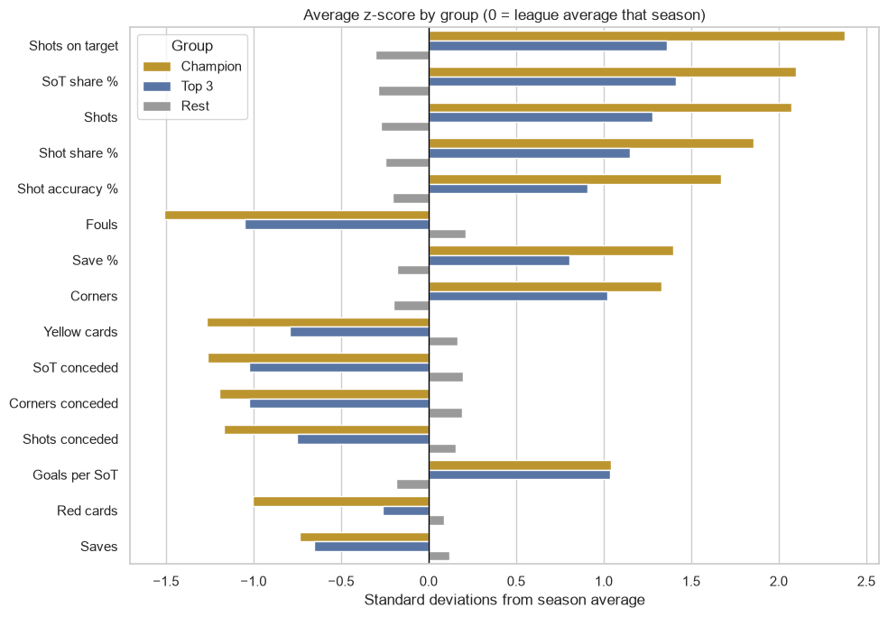
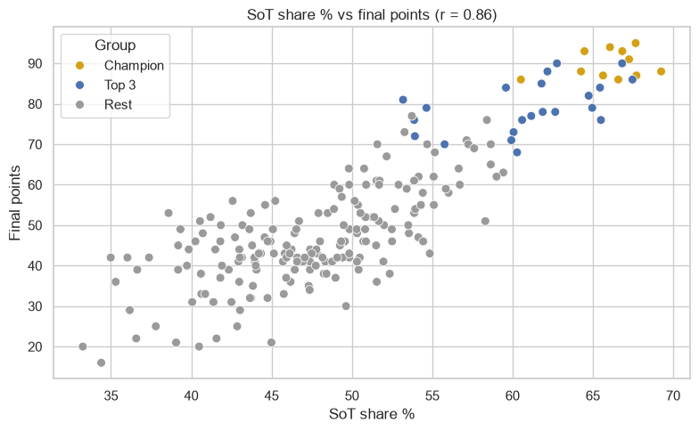
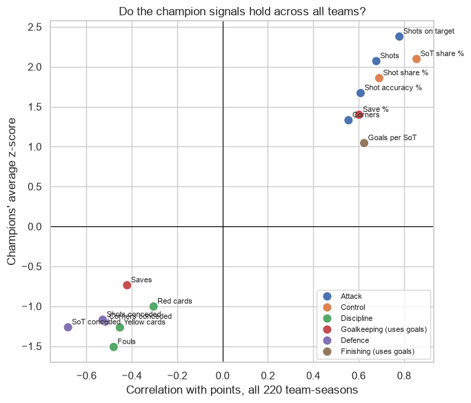
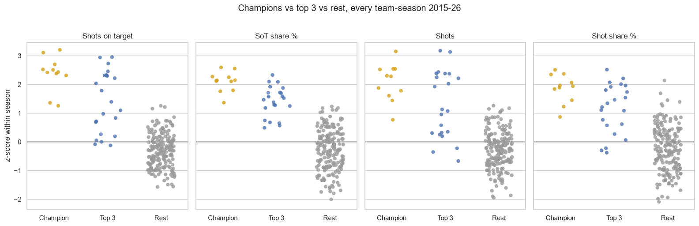

# What Makes a Team Win La Liga?

An exploratory data analysis of **11 La Liga seasons (2015-16 to 2025-26, 4,180 matches)** that compares champions with the other top-3 teams and with the rest of the league, to find which match statistics separate title winners from everyone else.

**Main finding:** champions win the title by **controlling matches and creating the most shots on target**, not by finishing their chances better.



---

## Key findings

| # | Finding | Evidence |
|---|---|---|
| 1 | **Shots on target is the biggest gap** | Champions average **6.4 per game vs 3.9** for the rest of the league (+2.4 standard deviations above their season's average). The champion ranked in the league's top 3 for it in **10 of 11** seasons. |
| 2 | **Control of shots on target predicts points best** | A team's share of all shots on target in its matches correlates with final points at **r = 0.86** across all 220 team-seasons. Champions have about **66%** of the shots on target in their matches. |
| 3 | **Finishing doesn't separate the winner from the other contenders** | Champions and other top-3 teams score the same **0.36 goals per shot on target**. The gap between 1st and 2nd–3rd is in how many chances a team creates, not how well it finishes them. |
| 4 | **Defence and goalkeeping help, but less** | Champions face fewer shots and save a higher share of them (**75.6% vs 67.6%**). Their raw number of saves is *lower*, because they face fewer shots. |
| 5 | **Fewer fouls and cards** | Champions commit about **3 fewer fouls per game**. This is probably a result of having the ball, not a cause of winning. |
| 6 | **The champion signals hold for every team** | Every metric that marks out champions shows the same direction of correlation with points across the whole league, so these aren't quirks of 11 title winners. |

<p align="center">
  
  
</p>



---

## Method

1. **Build team-season data.** Each match becomes two rows, one per team. These are added up into one row per team per season (20 teams × 11 seasons = 220).
2. **Group teams.** Each season is ranked by points, with goal difference and then goals scored as tiebreakers. Teams are labelled **Champion** (1st), **Top 3** (2nd–3rd) or **Rest** (4th–20th).
3. **Per-match metrics.** 15 metrics covering attack, control, finishing, defence, goalkeeping and discipline, divided by 38 games.
4. **Standardise within each season.** Each metric is turned into a z-score relative to that season's league, so different seasons can be pooled fairly.
5. **Compare groups.** The size of the champions' gap, the gap between the champion and the other top-3 teams, and how often the champion ranked in the league's top 3 on that metric.
6. **Validate.** Each metric is correlated with final points across all 220 team-seasons, because 11 champions is a small sample.

The champions and top-3 places worked out from the match data match the real final standings in every season.

## Limitations

- **Correlation, not causation.** Teams that are winning play differently (a team behind chases the game), so some stats may be effects of the scoreline rather than causes of it.
- **The biggest driver isn't in the data.** Wages, transfer spending and squad quality likely drive both the stats and the points. Only Barcelona, Real Madrid and Atlético won the title in this period.
- **Small sample of champions:** 11 title winners from 3 clubs. The all-team correlations are the more reliable evidence.
- **Proxy metrics.** Saves are estimated as *shots on target conceded − goals conceded*. The data has no possession or expected goals (xG) figures.
- **Tiebreaks.** La Liga breaks ties on head-to-head results, while this analysis uses goal difference. The only tie at a group boundary (Atlético and Sevilla on 70 points in 2019-20) gives the same result either way.

---

## Project structure

```
├── data/raw/                 # SP1_<season>.csv match files from football-data.co.uk
├── figures/                  # charts used in this README
├── notebooks/
│   ├── champions.ipynb       # the finished analysis (start here)
│   └── eda.ipynb             # first exploratory pass over the match data
├── scripts/
│   └── download_data.py      # re-download the raw CSVs
└── requirements.txt
```

## How to run

```bash
python -m venv .venv
.venv\Scripts\activate          # Windows  (macOS/Linux: source .venv/bin/activate)
pip install -r requirements.txt

python scripts/download_data.py # optional: the CSVs are already in data/raw/
jupyter lab notebooks/champions.ipynb
```

## Data

Match results and statistics come from **[football-data.co.uk](https://www.football-data.co.uk/spainm.php)**, Spanish Primera División (`SP1`). Columns are described in the [football-data.co.uk notes](https://www.football-data.co.uk/notes.txt). The data is used here for non-commercial analysis, and all credit for collecting it goes to football-data.co.uk.
